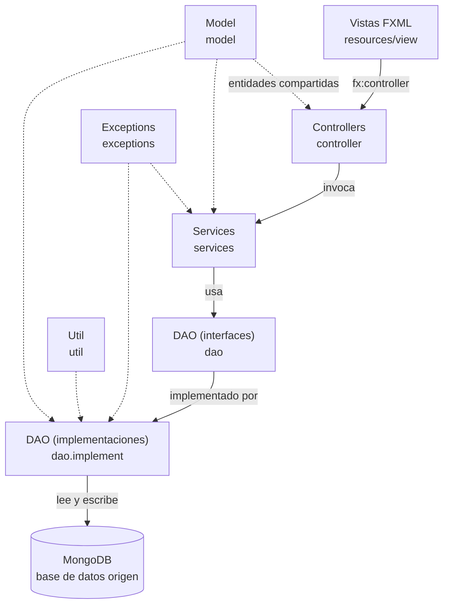
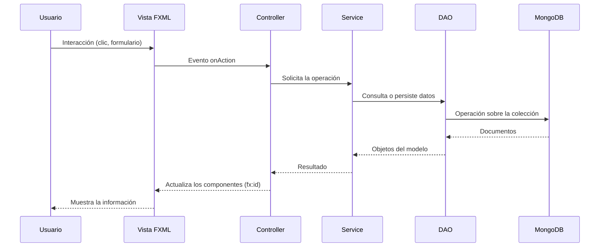

# ORIGEN BAR - Proyecto de aplicación

## 1. Configuración de la base de datos

### Requisitos

- **MongoDB Compass:** versión 1.53.2 o superior. [Descargar](https://www.mongodb.com/try/download/compass).

### Conexión

Conectarse desde MongoDB Compass a:

```text
mongodb://localhost:27017
```

Si no existe, crear la base de datos `origen`.

### Validación e importación de pedidos

1. Abrir el [validador](./datos/origen.validator.js) desde MongoDB Shell, conectado a `origen`, y ejecutar su contenido.
2. Importar los [pedidos](./datos/origen.pedidos.json) en la colección `pedidos` mediante **Add Data → Import JSON or CSV**.

### Importación de colecciones

Importar los siguientes ficheros desde MongoDB Compass mediante **Add Data → Import JSON or CSV**:

| Colección | Fichero |
|---|---|
| compras | [origen.compras.json](./datos/origen.compras.json) |
| movimientos_stock | [origen.movimientos_stock.json](./datos/origen.movimientos_stock.json) |
| permisos | [origen.permisos.json](./datos/origen.permisos.json) |
| productos | [origen.productos.json](./datos/origen.productos.json) |
| proveedores | [origen.proveedores.json](./datos/origen.proveedores.json) |
| registros_economicos | [origen.registros_economicos.json](./datos/origen.registros_economicos.json) |
| usuarios | [origen.usuarios.js](./datos/origen.usuarios.js) |

> **Nota:** Respetar los nombres de las colecciones indicados.

## 2. Instalación y ejecución

### Requisitos previos

| Herramienta | Versión recomendada | Descarga |
|---|---|---|
| JDK | 25 (mínimo 23, requerido por JavaFX 25) | [Descargar](https://adoptium.net/) |
| Apache Maven | 3.8 o superior | [Descargar](https://maven.apache.org/download.cgi) |
| MongoDB Community Server | Instancia local activa en el puerto 27017 | [Descargar](https://www.mongodb.com/try/download/community) |
| Git | Cualquier versión reciente | [Descargar](https://git-scm.com/downloads) |

Verificar la instalación desde una terminal:

```bash
java -version
mvn -version
git --version
```

### Pasos de instalación

1. Completar la configuración de la base de datos descrita en la sección 1. La base de datos `origen` debe estar creada y las colecciones importadas antes de iniciar la aplicación.
2. Clonar el repositorio:

   ```bash
   git clone https://github.com/vitadis/Grupo6-ADT-DIN-SGE.git
   cd Grupo6-ADT-DIN-SGE/origen
   ```

3. Compilar el proyecto y descargar las dependencias:

   ```bash
   mvn clean install
   ```

### Ejecución

Con MongoDB en ejecución, iniciar la aplicación desde la raíz del proyecto:

```bash
mvn javafx:run
```

La clase principal configurada en el `pom.xml` es `com.origen.App`. Como alternativa, el proyecto puede abrirse en un IDE (IntelliJ IDEA, Eclipse o NetBeans) y ejecutarse desde dicha clase.

### Generación del paquete

```bash
mvn clean package
```

El proyecto utiliza `maven-shade-plugin`, que empaqueta la aplicación y todas sus dependencias en un único fichero JAR dentro de `target`.

### Ejecución de pruebas

```bash
mvn test
```

Las pruebas de interfaz utilizan TestFX, por lo que requieren un entorno con pantalla disponible.

Los informes de resultados se generan en `target/surefire-reports`.

### Registro de eventos

La aplicación genera sus ficheros de registro en el directorio `logs`, ubicado en la raíz del proyecto.

## 3. Tecnologías utilizadas

| Tecnología | Versión | Uso en el proyecto |
|---|---|---|
| Java | JDK 25 en ejecución; código compilado con `release` 11 | Lenguaje principal de la aplicación |
| JavaFX (`javafx-controls`, `javafx-fxml`) | 25.0.1 | Interfaz gráfica de usuario y definición de las vistas mediante FXML |
| MongoDB Java Driver (`mongodb-driver-sync`) | 5.2.0 | Acceso síncrono a la base de datos desde la capa DAO |
| MongoDB y MongoDB Compass | Compass 1.53.2 o superior | Base de datos NoSQL y herramienta de administración e importación de datos |
| Maven | 3.8 o superior | Gestión de dependencias, compilación y ciclo de construcción |
| `javafx-maven-plugin` | 0.0.8 | Ejecución de la aplicación con `mvn javafx:run` |
| `maven-shade-plugin` | 3.6.0 | Empaquetado de la aplicación con sus dependencias en un único JAR |
| JUnit Jupiter | 5.10.2 | Pruebas unitarias (`src/test/java`) |
| TestFX (`testfx-core`, `testfx-junit5`) | 4.0.18 | Pruebas automatizadas de la interfaz JavaFX |
| Hamcrest | 2.2 | Aserciones en las pruebas |
| CSS | - | Estilos de la interfaz (`src/main/resources/css`) |

## 4. Arquitectura del proyecto

El proyecto sigue una arquitectura por capas basada en el patrón **MVC**, complementada con una capa de servicios y una capa de acceso a datos (DAO). Cada capa tiene una única responsabilidad y solo se comunica con la inmediatamente inferior, lo que facilita el mantenimiento y las pruebas.

### Estructura de directorios

```text
.
├── datos/                          Ficheros de importación para MongoDB
├── logs/                           Registros de ejecución
├── src/
│   ├── main/
│   │   ├── java/
│   │   │   ├── com/origen/         Clase principal de arranque
│   │   │   ├── controller/         Controladores asociados a las vistas FXML
│   │   │   ├── services/           Lógica de negocio
│   │   │   ├── dao/                Interfaces de acceso a datos
│   │   │   │   └── implement/      Implementaciones de los DAO sobre MongoDB
│   │   │   ├── model/              Entidades del dominio
│   │   │   ├── exceptions/         Excepciones propias de la aplicación
│   │   │   └── util/               Clases de utilidad (conexión, helpers)
│   │   └── resources/
│   │       ├── css/                Hojas de estilo
│   │       ├── img/productos/      Imágenes de productos
│   │       └── view/               Vistas FXML organizadas por módulo
│   │           ├── admin/
│   │           ├── caja/
│   │           ├── compra/
│   │           ├── economia/
│   │           ├── gestionStock/
│   │           └── inicio/
│   └── test/java/
│       ├── dao/implement/          Pruebas de la capa de acceso a datos
│       └── view/                   Pruebas de la capa de vista
├── target/                         Artefactos generados por Maven
└── pom.xml                         Configuración de Maven
```

### Descripción de los paquetes

| Paquete | Responsabilidad |
|---|---|
| `com.origen` | Punto de entrada (`App`). Inicializa JavaFX y carga la primera vista. |
| `controller` | Gestiona los eventos de la interfaz, valida la entrada del usuario e invoca a los servicios. No contiene lógica de acceso a datos. |
| `services` | Contiene las reglas de negocio y coordina las operaciones entre varios DAO. |
| `dao` | Define los contratos de acceso a datos mediante interfaces. |
| `dao.implement` | Implementa los contratos del paquete `dao` utilizando el driver de MongoDB. |
| `model` | Clases que representan las entidades del dominio (por ejemplo, producto, pedido, proveedor, usuario). |
| `exceptions` | Excepciones específicas que permiten propagar errores de negocio y de persistencia de forma controlada. |
| `util` | Componentes transversales, como la gestión de la conexión a MongoDB. |

### Diagrama de capas



### Conexión entre las vistas FXML y los controllers

Cada fichero FXML declara su controlador mediante el atributo `fx:controller`. Al cargar la vista con `FXMLLoader`, JavaFX instancia el controlador, inyecta en sus atributos los componentes marcados con `fx:id` y enlaza los eventos declarados en el FXML con los métodos del controlador.



Elementos que intervienen en el enlace:

| Elemento en el FXML | Elemento en el controller | Función |
|---|---|---|
| `fx:controller="paquete.NombreController"` | Clase `NombreController` | Asocia la vista con su controlador. |
| `fx:id="nombreComponente"` | Atributo anotado con `@FXML` | Inyecta el componente gráfico en el controlador. |
| `onAction="#metodo"` | Método `@FXML void metodo()` | Enlaza el evento del componente con la lógica del controlador. |

Ejemplo genérico:

```xml
<!-- resources/view/modulo/vista.fxml -->
<AnchorPane fx:controller="controller.ModuloController">
    <Button fx:id="btnGuardar" text="Guardar" onAction="#guardar"/>
</AnchorPane>
```

```java
// controller/ModuloController.java
public class ModuloController {

    @FXML
    private Button btnGuardar;

    @FXML
    private void guardar() {
        // Valida la entrada y delega la operación en el servicio
    }
}
```

### Organización de las vistas por módulo

| Módulo | Ubicación de las vistas | Ámbito funcional |
|---|---|---|
| Inicio | `view/inicio` | Acceso a la aplicación y navegación principal |
| Administración | `view/admin` | Gestión de usuarios y permisos |
| Caja | `view/caja` | Registro y cobro de pedidos |
| Compra | `view/compra` | Compras a proveedores |
| Gestión de stock | `view/gestionStock` | Inventario y movimientos de stock |
| Economía | `view/economia` | Registros económicos |

## 5. Funcionalidades

## 6. Autores

| Nombre | Repositorio |
|---|---|
| Joel | [github.com/vitadis](https://github.com/vitadis/) |
| An | [github.com/Azkona05](https://github.com/Azkona05) |
| Hodei | [github.com/HodeiTorres33](https://github.com/HodeiTorres33) |
